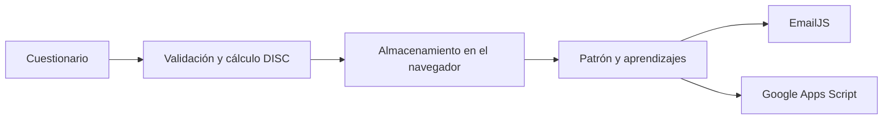

# Professional Landing · Test DISC
### Evaluación de perfiles y orientación de aprendizajes


Módulo web del proyecto colaborativo Professional Landing de Duoc UC Plaza Oeste. Presenta un cuestionario DISC, procesa las respuestas y muestra un patrón de personalidad junto con niveles de Onboarding y aprendizajes sugeridos.

La aplicación está construida con HTML, CSS y JavaScript, sin un proceso de compilación. Integra persistencia en el navegador y servicios externos para el envío de resultados y el registro de información.

## Funcionalidades

- Cuestionario dinámico de 28 grupos de cualidades.
- Selección de la cualidad que representa en mayor y menor grado a cada participante.
- Validación de respuestas completas y de selecciones incompatibles.
- Cálculo de puntajes, intensidades y segmentos DISC.
- Presentación del patrón, descripción y aprendizajes asociados.
- Persistencia con LocalStorage y respaldo con SessionStorage.
- Envío de resultados mediante EmailJS.
- Envío de datos a un endpoint de Google Apps Script.
- Interfaz adaptable a móviles, con ayudas de vocabulario y soporte de interacción por teclado.

Este repositorio contiene el módulo DISC. Otros componentes de Professional Landing, como el sitio informativo o un módulo independiente de QR, no forman parte de esta carpeta de código.

## Tecnologías

| Área | Herramientas |
| --- | --- |
| Interfaz | HTML, CSS y JavaScript |
| Persistencia local | LocalStorage y SessionStorage |
| Correo | EmailJS Browser SDK |
| Integración de datos | Endpoint de Google Apps Script |
| Publicación | Archivos estáticos compatibles con GitHub Pages |

## Flujo de la aplicación



## Ejecutar localmente

Necesitas Git, un navegador moderno y Python para servir los archivos de forma local.

```bash
git clone https://github.com/FRojasRiffo/DISC.git
cd DISC
python -m http.server 8000
```

Abre **http://localhost:8000/** y comienza desde `index.html`. No se requiere `npm install`.

Usar un servidor local evita las restricciones de almacenamiento que algunos navegadores aplican a los archivos abiertos con `file://`. El cuestionario y sus resultados pueden revisarse sin configurar un servidor propio; el envío de correos y el registro externo requieren conexión a Internet y servicios configurados.

## Configurar las integraciones

### EmailJS

En [patron.html](patron.html), configura con los valores de tu propio servicio:

- `EMAILJS_SERVICE_ID`
- `EMAILJS_TEMPLATE_ID`
- `EMAILJS_PUBLIC_KEY`

La plantilla debe aceptar los parámetros enviados por el código. La [guía de EmailJS](EMAILJS_SETUP.md) detalla los campos, como `to_email`, `patron_name`, `patron_description`, `segments` y `code`. Toma los valores y nombres actuales del código como referencia, sin depender de números de línea.

### Google Apps Script

El envío se realiza desde `patron.html` mediante una llamada `fetch` a una aplicación web de Apps Script. Para usar tu propia instancia:

1. Prepara y publica un endpoint que reciba los campos enviados por el formulario.
2. Reemplaza la URL del endpoint en `patron.html`.
3. Comprueba la recepción en tu destino de datos.

El código del endpoint de Apps Script no está incluido en este repositorio. Su configuración y la del almacenamiento de destino se realizan por separado. Para una copia o demostración, reemplaza las integraciones existentes por las tuyas antes de enviar datos.

## Recorrido de demostración

1. Abre el cuestionario y cierra el mensaje de bienvenida.
2. Selecciona una opción de mayor y otra de menor afinidad en cada grupo.
3. Intenta enviar una respuesta incompleta para revisar la validación.
4. Completa los grupos y envía las respuestas.
5. Revisa el patrón y los aprendizajes en la página de resultados.
6. Si configuraste servicios propios, comprueba el envío por correo y el registro externo.

El botón **Randomize Answers** permite preparar una prueba rápida del recorrido. Las respuestas aleatorias son para demostración.

## Estructura

| Archivo | Responsabilidad |
| --- | --- |
| `index.html` | Entrada, bienvenida y formulario |
| `questions.js` | Grupos de cualidades y descripciones |
| `disc.js` | Generación del cuestionario, validaciones y cálculo |
| `patron.html` | Resultados, formulario e integraciones |
| `patrones.js` | Información de patrones |
| `job-offers.js` | Datos de apoyo a la orientación |
| `styles.css` | Estilos principales |
| `results.js` y `results.css` | Recursos adicionales de resultados |
| `EMAILJS_SETUP.md` | Guía de configuración del correo |

## Publicación

Los archivos pueden servirse desde un alojamiento estático como GitHub Pages. Mantén `index.html` en la raíz y conserva las rutas relativas a los scripts, estilos e imagen del banner. Configura las integraciones para el dominio utilizado antes de probar el envío.

## Estado y próximos pasos

El repositorio no incluye una suite de pruebas automatizadas ni el código de Apps Script. Las mejoras previstas son separar la lógica de resultados de `patron.html`, centralizar la configuración de integraciones y añadir pruebas para las reglas de cálculo y validación.

## Autor

[Felipe Antonio Rojas Riffo](https://github.com/FRojasRiffo) · Ingeniería en Informática, Duoc UC
